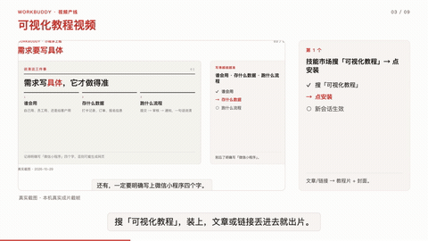
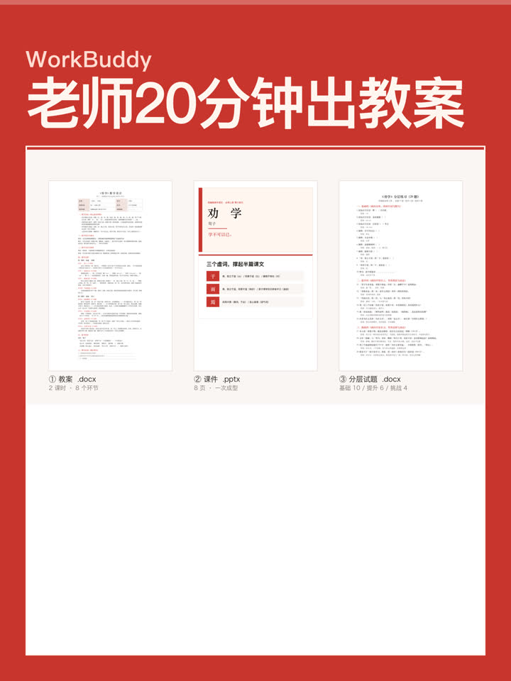
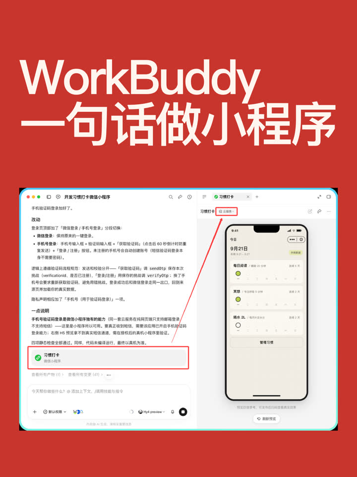
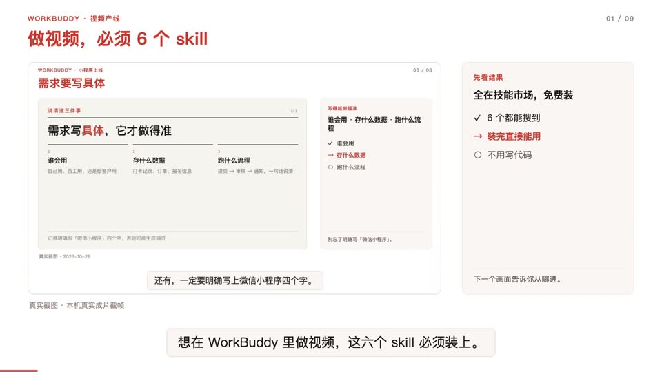
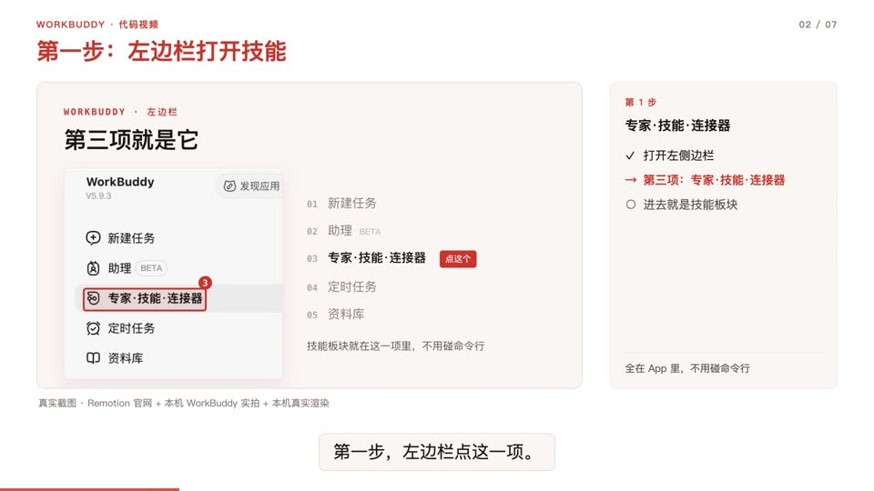
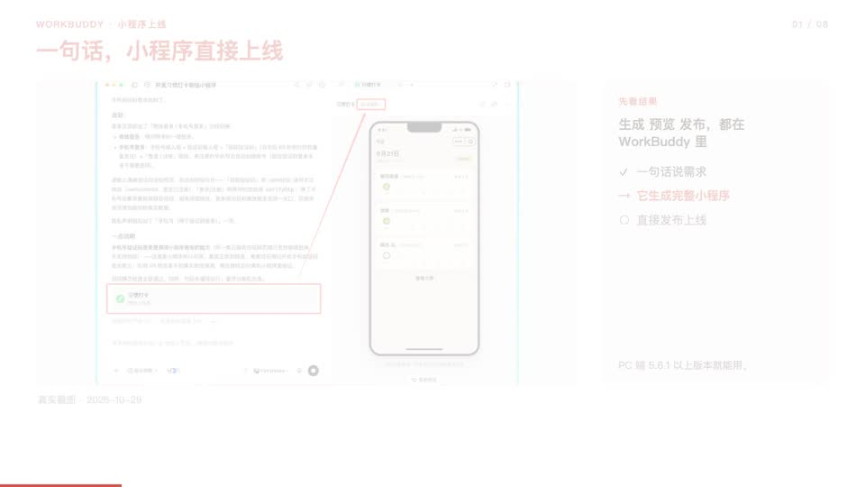

# 自动化教程 Skill

> 🔴 **作者：袁六伟 · 台州汇芯**｜一人 AI 公司创业者，6000+ 学员，100+ 客户，得到/华为分享老师
> 📮 更多 AI 视频与自动化实战，关注 **公众号 / 视频号：袁六伟**

## 效果展示

以下画面均来自本 Skill（WorkBuddy 名：`可视化教程视频`，封面规范第 6 版）**今天实操成片**，禁止 AI 编造界面。界面版权属 WorkBuddy；成片由作者本人用本 Skill 产出。

<p align="center"></p>

<p align="center"><sub>成片动态：讲解面板 + 底部字幕（截取自《做视频，必须 6 个 skill》2026-10-30 成片）</sub></p>

### 封面（第 6 版：深空底 + 红胶囊 + 思源黑体 900 + 矢量图形）

| 做视频必装 6 个 skill | 教师篇：20 分钟出全套教案 | 一句话做小程序 |
|:---:|:---:|:---:|
|  |  |  |

### 成片抽帧（真实界面 + 旁白字幕）

| 6 个 skill · 开场 | 代码视频 · 真机步骤 | 小程序 · 先看结果 |
|:---:|:---:|:---:|
|  |  |  |
| 《做视频，必须 6 个 skill》 | 《WorkBuddy 1 分钟学会做代码视频》 | 《WorkBuddy 一句话做小程序》 |


## 统一结尾 CTA（2026-10-30 下午增量）

成片末镜固定旁白与画面：**评论区回复666，送你2693元的一人公司福利包。**（禁职业分支口令、不要说点关注；画面 `skills/auto-tutorial/assets/cta-666.png`，脚本 `skills/auto-tutorial/scripts/standard_cta.py`。）另含 100 个职业系列封面规则与清单/盘点类选题硬规则；封面规范仍为**第 6 版**（未升第 7 版）。

## 一句话卖点

**完全自动化**：给文章链接 / 网页文档 / 截图 / 录屏 → 自动取画面 → 分镜旁白 → 3:4 封面 → 配音字幕 → 成片与备选标题。中间不用碰剪辑软件。

主用 **WorkBuddy**（[open.workbuddy.cn](https://open.workbuddy.cn) / WorkBuddy App）。Skill 结构通用，Claude Code、Codex、Cursor 等也可安装，但截图/录屏入口、VoiceBox 配音等需**自行适配**本机界面与工具链。

*Fully automated visual tutorials: link / page / screenshots / screencast in → cover + narrated video out. Built for WorkBuddy; adapt tooling yourself on other agent platforms.*

## 三类输入 → 同一套产出

| 你给什么 | 它怎么取画面 | 你得到什么 |
|---|---|---|
| 文章链接（公众号 / 网页） | 抓正文 + 下载配图，自动分镜 | 16:9 成片 + 3:4 封面 + 字幕/章节/备选标题 |
| 网页 / 文档地址 | 自动打开、点击、滚动，真实关键截图 | 同上 |
| 截图 / 录屏 | 直接入片，自动配版式与说明卡 | 同上 |

## 安装

```bash
npx skills add sixwei2025/auto-tutorial-skill
```

或把本仓库 `skills/auto-tutorial/` 整个文件夹拷进 agent 的 skills 目录（WorkBuddy 识别 frontmatter 名 `可视化教程视频`）。

## 依赖

**必需**
- Python 3.10+（`playwright`、`Pillow`）
- ffmpeg / ffprobe（需 libx264、aac；字幕画在页面里，不需要 libass）
- 系统 Chrome / Edge（或 Playwright 自带内核）

**可选**
- 本机 VoiceBox（默认 `http://127.0.0.1:17493`，可用 `VOICEBOX_API` 改）
- 中文字体：仓库已带 `assets/fonts/NotoSansSC-VF.ttf`（封面第 6 版思源黑体 900）

VoiceBox 示例（请换成你自己的音色名，公开包不内置私人声纹）：

```bash
export VOICEBOX_API='http://127.0.0.1:17493'
export VOICEBOX_PROFILE='YourVoice'
# 或在 project.json 写 voice.profile_name / voice.profile_id
```

## 快速开始

对 WorkBuddy / agent 说：

> 用可视化教程视频 skill，把这篇链接做成教程片

或手动：

```bash
mkdir my-video && cd my-video
TV_PROJECT=$PWD python3 <本仓库>/skills/auto-tutorial/scripts/build_all.py --url https://mp.weixin.qq.com/s/xxxx
```

更细的字段与踩坑见 `skills/auto-tutorial/QUICKSTART.md` 与 `skills/auto-tutorial/SKILL.md`。

## 许可

MIT。代码开源。配音的声音、字体授权、配乐、平台账号请使用你自己有授权的资源；本仓库不附带任何私有 VoiceBox 档案或账号密钥。

---

## 关于作者

**袁六伟 · 台州汇芯**：一人 AI 公司创业者，6000+ 学员，100+ 客户，得到/华为分享老师。专注 AI 视频与自动化落地。

- 公众号：**袁六伟**
- 视频号：**袁六伟**

这个 Skill 免费开源。觉得有用的话，欢迎点个 ⭐ Star，再关注公众号或视频号「袁六伟」。企业合作可通过公众号联系。

更多开源 Skill：[talking-head-video-skill](https://github.com/sixwei2025/talking-head-video-skill)、[3d-map-video-skill](https://github.com/sixwei2025/3d-map-video-skill)、[psych-kepu-video-skill](https://github.com/sixwei2025/psych-kepu-video-skill)、[dark-infographic-video-skill](https://github.com/sixwei2025/dark-infographic-video-skill)
