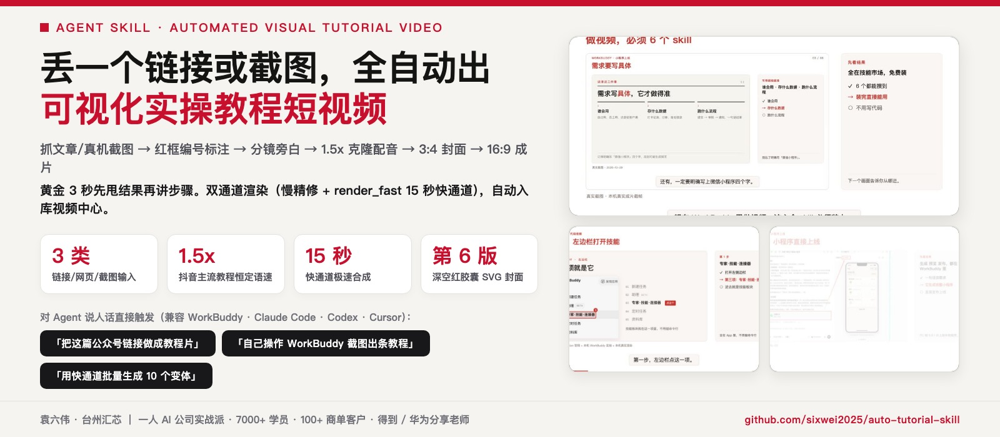
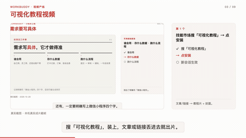
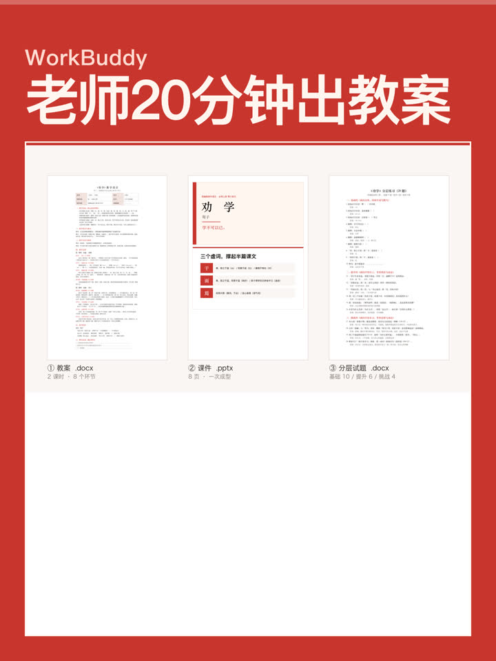
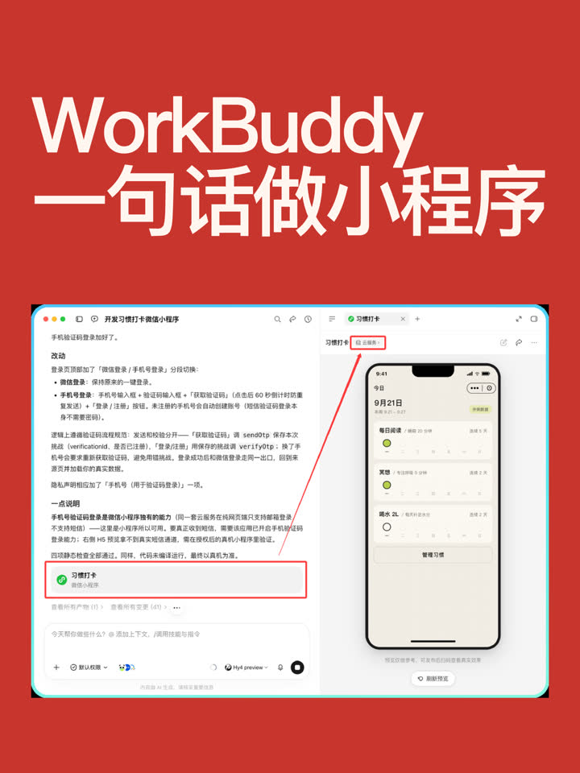
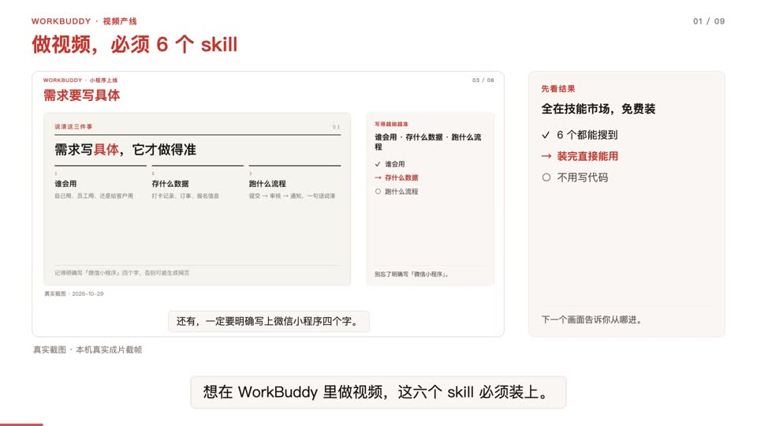
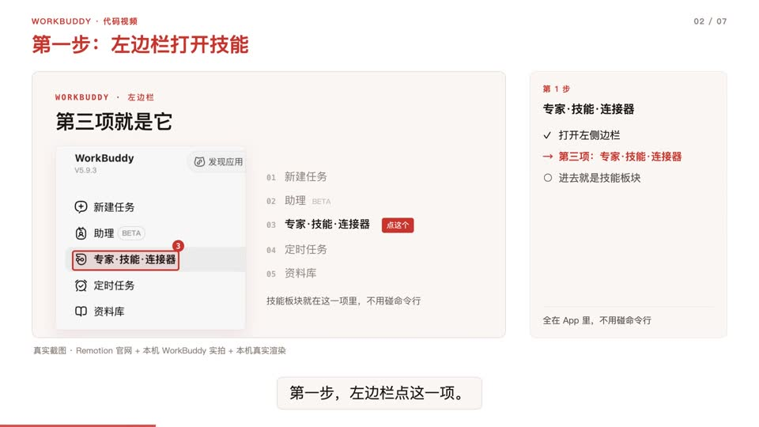
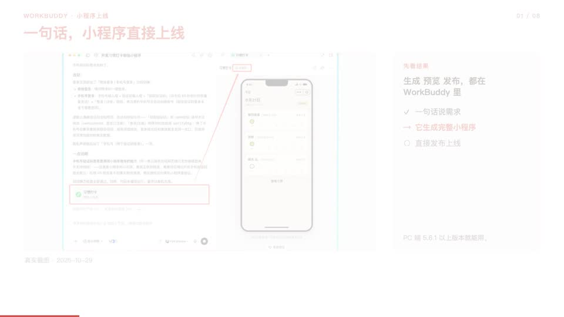
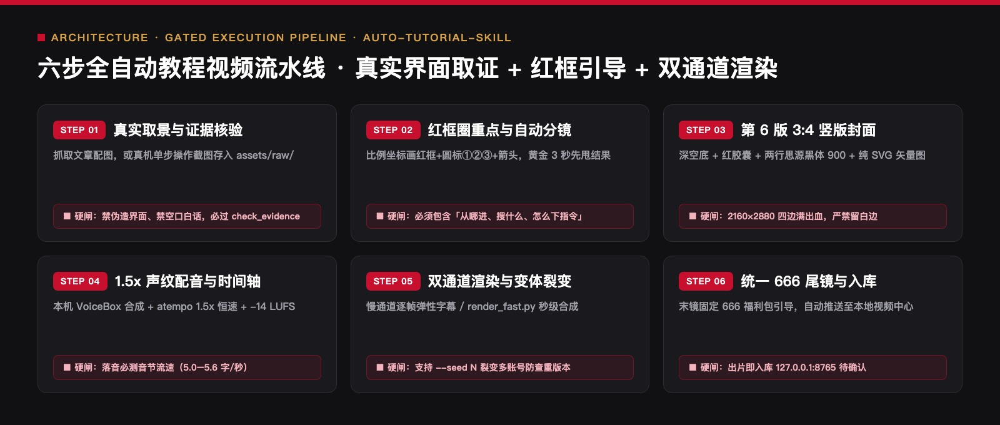

<div align="center">



# 自动化实操教程视频 Skill
### `auto-tutorial-skill` · 链接 / 网页 / 真机截图 → 3:4 封面 + 1.5x 配音 + 红框标注教程成片

[](https://agentskills.io)
[](#五环境依赖与-3-分钟安装)
[](#四双通道渲染与矩阵号防查重裂变)
[](LICENSE)

> 🔴 **作者：袁六伟 · 台州汇芯**｜一人 AI 公司创业者，学员 7000+，客户 100+，得到 / 华为分享老师  
> 📮 更多 AI 视频与自动化实战，关注 **公众号 / 视频号：袁六伟**

**不用开剪映、不用手画红框、不用逐句对齐字幕。**  
给它一篇公众号链接、一个网页地址、或一组真实操作截图，一条命令全自动跑完：**抓取/真机取景 → 红框圆标圈重点 → 黄金 3 秒先甩结果分镜 → 第 6 版深空矢量 3:4 封面 → 1.5x 恒速克隆配音 → 成片合成 + 8 选 3 爆款标题 + 自动推送到本地视频中心**。

```bash
# 一键安装 Skill
npx skills add sixwei2025/auto-tutorial-skill

# 给一篇公众号文章链接，全自动跑出 16:9 教程成片 + 3:4 封面 + 字幕 + 标题
TV_PROJECT=~/my-video python3 skills/auto-tutorial/scripts/build_all.py --url https://mp.weixin.qq.com/s/xxxx
```

[看真实成片效果](#一看真实实操成片效果) · [三类输入全自动流转](#二三类输入--同一套标准化交付物) · [六步工程流水线](#三六步制作流水线与核心设计原则) · [15 秒快通道与矩阵裂变](#四双通道渲染与矩阵号防查重裂变) · [安装配置](#五环境依赖与-3-分钟安装)

</div>

## 新手安装：把链接发给 AI

打开 Codex、WorkBuddy，或其他支持技能安装的 AI 智能体，把下面这段话直接发到对话框，让它帮你安装：

```text
帮我安装这个仓库里的技能：
https://github.com/sixwei2025/auto-tutorial-skill
```

不需要自己先敲安装命令，按 AI 的提示完成即可。安装后可以接着问：“这个技能怎么用？带我做一个最简单的例子。”

需要使用能够读取仓库、操作本地文件并支持技能安装的 AI；如果当前平台不支持，它可以提供手动安装指引。部分技能还需要额外软件或账号配置，安装技能与完成这些配置是两步，按本页说明和 AI 提示继续。


---

## 一、看真实实操成片效果

以下画面全部由本 Skill（WorkBuddy 内部名：`可视化教程视频`，封面规范第 6 版）**真实跑出**，严禁使用 AI 伪造软件界面：

<p align="center">
  
  <br /><sub><b>▲ 成片动态实拍</b>：左侧真实软件界面 + 右侧步骤 Checklist 面板 + 底部弹入字幕（截取自《做视频，必须 6 个 skill》成片）</sub>
</p>

### 1.1 封面第 6 版（2160×2880 满出血 3:4 竖版：深空底 + 红胶囊 + 思源黑体 900 + 纯 SVG 矢量图形）

| 《做视频必装 6 个 skill》 | 《教师篇：20 分钟出全套教案》 | 《一句话做小程序》 |
| :---: | :---: | :---: |
|  |  |  |
| `motif: play`（播放圆盘+时间线） | `motif: grid`（透视卡片+金表头） | `motif: nodes`（核心+卫星节点） |

### 1.2 成片分镜抽帧（全景真机截图 + 红框编号引导 + 右侧步骤面板）

| 6 个 Skill · 黄金 3 秒开场 | 代码视频 · 真机入口定位 | 小程序 · 先甩真机结果 |
| :---: | :---: | :---: |
|  |  |  |

---

## 二、三类输入 → 同一套标准化交付物

| 你丢给 Agent 什么 | 脚本怎么自动取画面 | 最终交付给你的 5 件套 |
| :--- | :--- | :--- |
| **① 文章链接**（公众号 / 网页教程） | `fetch` 自动抓正文 + 下载全部配图，缺图段落自动生成高质感说明卡 | 1. `delivery/<slug>-16x9.mp4`（含章节标记）<br>2. `cover/cover-3x4.png`（2160×2880 满出血封面）<br>3. `delivery/captions.srt/.vtt/.ass`<br>4. `delivery/titles.md`（8 选 3 爆款标题）<br>5. 自动入库 `127.0.0.1:8765` 本地视频中心 |
| **② 网页 / 本地桌面 App** | Agent 真机单步操作并截图存入 `assets/raw/`，过 `check_evidence.py` 验真 | 同上（支持 `annotations` 自动画红框、圆标①②③与箭头） |
| **③ 现成截图集 / 已有视频片段** | `assets` 自动 2× 超分去白边，手机竖图自动排成「左文右机」16:9 卡片 | 同上 |

---

## 三、六步制作流水线与核心设计原则

<p align="center">
  
</p>

### 写进代码的 5 条爆款教程原则

1. **黄金 3 秒先甩结果，绝不以「今天教大家安装」开场**：前 0–3 秒直接展示最终跑出来的震撼结果（如「788 条数据，我全程没点一次鼠标」），第 8 秒后再按步骤 1→2→3 拆解。
2. **小白上手三要素**：每一步必须交代清楚 **「点哪里（精确路径）→ 看到什么反馈 → 完了长什么样」**，并单独留出一段展示**「具体怎么给 AI 下指令的原话」**。
3. **全景截图 + 红框编号引导（不靠盲目放大）**：信息密集的界面保持全景位置感，通过 `annotations` 比例坐标自动绘制 `#C7352D` 红框 + 外浮圆标 `①②③` + 指示箭头；隐私侧栏自动局部高斯模糊。
4. **全程恒定 1.5x 语速（抖音主流节奏）**：通过 `ffmpeg atempo=1.5` 变速不变调，落音后自动测算音节流速（稳定在 `5.0–5.6 音节/秒`），思考留白靠 `lead/tail` 气口调节，绝不降速拖泥带水。
5. **封面四件套满出血设计**：深空蓝黑底 + 顶部红胶囊（`WorkBuddy实操`）+ 两行思源黑体 900 大字（白+金）+ 11 款内置纯 SVG 矢量图形（`orbit / nodes / grid / play / people / ledger / scale...`），四边零白边。

---

## 四、双通道渲染与矩阵号防查重裂变

针对「单条精品深加工」与「矩阵号批量铺量」两种场景，内置两条渲染通道：

| 渲染通道 | 命令 | 30 秒成片耗时 | 适用场景 |
| :--- | :--- | :---: | :--- |
| **慢通道（精修）** | `python3 scripts/build_all.py` | ~75 秒 | 单条主力号精修，带 HTML 逐字弹性字幕与叠化转场 |
| **快通道（铺量）** | `python3 scripts/render_fast.py --jobs 4` | **~12–15 秒** | PIL 静态层 + FFmpeg `filter_complex` 一次合成，适合矩阵号批量出片 |

### `--seed N` 确定性矩阵裂变（一条工程裂变几十个防查重版本）
```bash
# 用同一个项目派生第 7 号确定性变体（自动微调推拉幅度/方向、字幕字号/高度、1.5% 裁切位移并轮换 BGM）
TV_PROJECT=$PWD python3 skills/auto-tutorial/scripts/render_fast.py --seed 7 --out delivery/v07.mp4
```

---

## 五、环境依赖与 3 分钟安装

### 1. 安装 Skill
```bash
npx skills add sixwei2025/auto-tutorial-skill
```

### 2. 环境依赖
- **Python 3.10+**：`pip3 install playwright pillow`
- **FFmpeg / FFprobe**：需包含 `libx264` 与 `aac`（字幕直接渲染在画面层，无需编译 `libass`）
- **浏览器**：系统 Google Chrome / Edge 或 Playwright Chromium
- **中文字体**：仓库已内置 `NotoSansSC-VF.ttf`（思源黑体可变字重，开箱即用）
- **配音（可选）**：支持本机 VoiceBox（`http://127.0.0.1:17493`），公开仓库不含任何私人声纹档案

---

## 六、仓库目录结构

```text
auto-tutorial-skill/
├── README.md                                  # 仓库总览与成片动图展示
├── LICENSE                                    # MIT 开源许可
├── assets/showcase/                           # 成片 GIF、第 6 版 3:4 封面样张、分镜抽帧与架构图
└── skills/auto-tutorial/
    ├── SKILL.md                               # 【总控入口】全流程参数、盘点类四规则、真机取证与设计铁律
    ├── QUICKSTART.md                          # 3 分钟上手指南与常见排错
    ├── assets/
    │   ├── fonts/NotoSansSC-VF.ttf            # 内置思源黑体 900 可变字体
    │   └── cta-666.png                        # 统一末镜 666 福利包引导画面
    ├── templates/
    │   ├── cover-videohao.html                # 第 6 版深空红胶囊 3:4 封面模板
    │   ├── render.html                        # 16:9 左图右面板教学渲染模板
    │   └── motifs/                            # 11 款纯 SVG 行业矢量图形（orbit/grid/nodes/code 等）
    ├── references/
    │   └── real-operation.md                  # 真机单步操作取证与隐私脱敏闭环规范
    └── scripts/
        ├── build_all.py                       # ★ 全链路总控脚本（支持 --url / --only / --from）
        ├── render_fast.py                     # ★ 15 秒极速合成与 --seed 矩阵裂变渲染器
        ├── make_cover.py                      # 3:4 封面渲染与四边满出血检测器
        ├── standard_cta.py                    # 一键注入标准末镜 CTA 工具
        ├── check_evidence.py                  # 真机截图证据链校验器
        └── push_library.py                    # 自动同步成片至本地视频中心（127.0.0.1:8765）
```

---

## 关于作者与开源生态

**袁六伟 · 台州汇芯**：一人 AI 公司创业者，学员 7000+，服务商单客户 100+，覆盖近 20 个行业，得到 / 华为分享老师。AI 变现实战派，自己跑通才拿出来教。

- 公众号：**袁六伟**（微信搜一搜关注，看更多 AI 工具实测与一人公司实战）
- 视频号：**袁六伟**

这个项目免费开源。如果它帮你的产线省下了每天反复返工的时间，欢迎在右上角点个 ⭐ **Star**，也欢迎转发给身边做内容或一人公司的朋友。

### 同系列开源 Skill 矩阵（袁六伟 · 台州汇芯）

| 仓库 | 领域 | 核心能力 |
| :--- | :--- | :--- |
| [**workbuddy-wechat-autopilot**](https://github.com/sixwei2025/workbuddy-wechat-autopilot) | 公众号全链路 | 九步全自动总控：选题→写稿→真实截图→6套封面→6套排版→三重自动质检→草稿箱 |
| [**wechat-cover-skill**](https://github.com/sixwei2025/wechat-cover-skill) | 公众号视觉 | 封面渲染引擎（6套高客单价杂志风 + 黑红金 v2b + 防压脸自动校验） |
| [**gzh-million-layout-skill**](https://github.com/sixwei2025/gzh-million-layout-skill) | 公众号排版 | 汇芯红 `#C8102E` 六套 100% 内联 CSS 骨架 + 零乱码检查 + 配图皮肤 |
| [**ai-tool-review-wechat-skill**](https://github.com/sixwei2025/ai-tool-review-wechat-skill) | 公众号评测 | AI 工具真跑评测工作流（2.0 全自动压测 + 去碎句语感质检 + 六套骨架装配） |
| [**hit-title-expert-skill**](https://github.com/sixwei2025/hit-title-expert-skill) | 爆款标题 | 一次直出 10 条 14–22 字高浓缩狠标题（5大公式 × 5类钩子词） |
| [**auto-tutorial-skill**](https://github.com/sixwei2025/auto-tutorial-skill) | 短视频工程 | 链接/网页/真机截图 → 3:4 封面 + 1.5x 配音 + 红框标注教程视频 |
| [**talking-head-video-skill**](https://github.com/sixwei2025/talking-head-video-skill) | 短视频工程 | 1080×1920 竖屏真人口播短视频（ASR 错字校对 + 逐字卡拉OK字幕 + 6项QC） |
| [**3d-map-video-skill**](https://github.com/sixwei2025/3d-map-video-skill) | 短视频工程 | MapLibre 3D 地形 + WarFX 战争特效（粒子行军/点阵兵力/震屏混音） |
| [**psych-kepu-video-skill**](https://github.com/sixwei2025/psych-kepu-video-skill) | 短视频工程 | Remotion + JSON 驱动的 15–30s 深色扁平动画心理科普短视频 |
| [**dark-infographic-video-skill**](https://github.com/sixwei2025/dark-infographic-video-skill) | 短视频工程 | 纯 Python + FFmpeg 暗黑流光数据可视化科普片（含 v2 手机外放配乐） |
| [**local-video-hub**](https://github.com/sixwei2025/local-video-hub) | AI 团队基建 | 视频版本地 Obsidian：多 AI 员工统一交片、撞题查重与四态流转云台 |
| [**yuanliuwei-ai-skills**](https://github.com/sixwei2025/yuanliuwei-ai-skills) | 一人公司方法 | PACT 72h 需求验证模型与一人 AI 公司 10 大业务决策模块 |
| [**book-skill**](https://github.com/sixwei2025/book-skill) | 知识工程 | 上传任意书籍 PDF → 自动提炼方法论生成 `.skill` + 公众号导流文案 |
| [**huangdi-skill**](https://github.com/sixwei2025/huangdi-skill) | 认知操作系统 | 中国历史八大皇帝（秦始皇/汉武帝/唐太宗等）一手史料认知框架蒸馏 |
| [**sunrise-tracker**](https://github.com/sixwei2025/sunrise-tracker) | 选题雷达 | 小红书 AI 赛道 10 倍异常流量「低粉爆文」每日早 7 点监测推送 |
